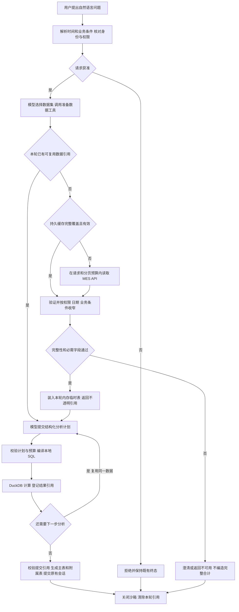

# API 数据驱动的 SageQL 分析实现说明

更新日期：2026-10-14。

系统以 MES 只读 API 为数据源，优先使用已有缓存，将本次获准的数据装入 DuckDB 内存临时表，
再执行本地计算。MES 无需提供 SQL 接口或数据库连接，也无需额外部署分析数据库服务。
SQL 由宿主程序根据结构化计划生成，只用于计算本轮临时表中的数据。

现有 13 个 L1 能力继续执行受审配方；L1 不能完整表达的问题进入 L2，由 SageQL core
根据安全工具观察继续规划。模型选择数据和计算步骤，程序完成取数、权限校验、计算与结果交付。

## 组件分工

| 组件 | 职责 |
| --- | --- |
| SageQL core | 独立 wheel；提供通用工具协议、多轮控制、累计预算、取消和无进展检测 |
| 模型适配 | 使用现有 LiteLLM 网关；输出数据查询和分析计划，不输出自由 SQL |
| 数据 Provider | 先复用本轮数据，再查持久缓存，不足时受限调用 MES；验证并收窄授权数据 |
| 语义目录与知识 | 定义可用数据集、字段、指标和业务口径；纯术语解释直接检索批准知识 |
| 结构化计算 | 校验数据引用、字段、指标及关联关系，将计划编译成受限本地 SQL |
| 交互沙箱与结果 | 每轮一个 DuckDB 内存连接；交付验证结果，沿用既有卡片、会话、导出和计量流程 |

事实使用 V2 报工和进度两族。基础字典与配置使用仍适用的 V1 只读接口及现有目录缓存，
适用于当前租户的所有角色；事实和工资仍按原角色及数据范围授权。纯知识解释不需要业务取数。

## 事实查询处理流程



模型只看到字段、覆盖、完整性、行数和不透明引用等安全信息，不接收原始业务记录。
权限和身份在数据动作前重新核对；取消、超时或预算耗尽进入既有停止流程，计算收束后释放资源。

## 完整例子 床号上月报工量和每日趋势

### 问题与条件

老板在 2026-10-14 提问：“床号 1555 上个月报工量多少？按计划号分开，并给每日趋势。”

- 身份与范围：已授权的当前工厂老板范围，不跨租户。
- 时间：工厂时区 `Asia/Shanghai`，半开区间
  `[2026-09-01T00:00:00+08:00, 2026-10-01T00:00:00+08:00)`。
- 数据：`reported_production`，采用报工时间口径；不按进度的制单日期替代。
- 条件：床号字符串等于 `1555`，不把 `01555` 或近似床号合并。
- 本例假定：持久缓存完整覆盖所需窗口和字段，使用普通读取模式，不启用 shadow 校验。

### 数据准备

以下全部为合成数据，仅展示缓存中的示例片段，不代表客户记录或完整缓存。

| 报工日期 | 床号 | 计划号 | 工序 | 数量贡献 | 处理 |
| --- | --- | --- | --- | --- | --- |
| 2026-09-02 | 1555 | 计划A | 工序甲 | 2 | 保留 |
| 2026-09-03 | 1555 | 计划A | 工序乙 | 3 | 保留 |
| 2026-09-03 | 1555 | 计划B | 工序甲 | 4 | 保留 |
| 2026-09-03 | 01555 | 计划X | 工序甲 | 999 | 床号不相等，排除 |
| 2026-09-03 | 11555 | 计划Y | 工序甲 | 888 | 近似床号，排除 |
| 2026-08-31 | 1555 | 计划Z | 工序甲 | 100 | 不在报工窗口，排除 |

Provider 验证完整性、必需字段、日期和数量，并完成授权与条件过滤。
只有前三行进入内存临时表，宿主返回 `dataset:opaque-ref`。
这个引用代表本轮获准的数据集合，不能跨交互或跨租户使用。

### 两次计算与提交

一条合法的工具顺序为：查看数据描述 → `ensure_dataset` → `analyze_dataset`
→ 再次 `analyze_dataset` → `finish_or_clarify`。后续动作由模型根据安全观察提出，
数据准备和计算仍逐次通过宿主校验。

第一次按计划号合计，内部计划示意如下；引用实际由宿主产生。

```json
{
  "dataset_refs": ["dataset:opaque-ref"],
  "group_by": ["plan_code"],
  "metrics": [{"metric_id": "quantity", "operation": "sum"}]
}
```

第二次复用同一个数据引用，按报工日期生成每日趋势。

```json
{
  "dataset_refs": ["dataset:opaque-ref"],
  "time_bucket": {"field": "business_date", "unit": "day"},
  "metrics": [{"metric_id": "quantity", "operation": "sum"}]
}
```

宿主编译并执行这两个计划，分别登记结果引用。模型按“计划汇总、每日趋势”的顺序提交引用，
第一份作为主结果，第二份作为附属明细表，
每日趋势以表格交付，数据如下。

| 主结果 计划号 | 报工量 件·工序 |
| --- | --- |
| 计划A | 5 |
| 计划B | 4 |
| 合计 | 9 |

| 附属结果 报工日期 | 报工量 件·工序 |
| --- | --- |
| 2026-09-02 | 2 |
| 2026-09-03 | 7 |

答案从验证结果确定性组织，回显可见范围、结果行数、实际时间、床号条件、合计和数量口径，
其中报工量合计为 9 件·工序。计划A 和计划B 的数值由主表交付，每日数据由附属明细表交付。
件·工序不表示独立成衣完工件数；没有记录的日期不自动补成趋势零值。

本例只有一次数据准备、两次本地分析，新增 MES 业务请求为零。缓存不足时，先受限读取完整
问题窗口，验证后再执行相同计算；不借用年度预取的较大预算。token、目录冷态或 shadow
以及身份核验产生的请求须另行计量，不能混入普通热态零业务回源的收益。
回源后仍缺字段或分页不完整时，相关分析保持不可用，不提交完整合计。

## 实现边界与代码位置

模型不能更改租户、权限范围或凭据，不能提供原始 URL、自由 SQL、Python 或新业务公式。
本地分析只能使用已验证数据；缺字段、分页不完整、关联键不可靠或结果超限时，相关计算不可用，
不能用零值或部分数据冒充完整合计。整个交互最多一次语义修复，所有阶段共用累计执行预算。

| 代码 | 对应职责 |
| --- | --- |
| [L2 主入口](../../src/factory_agent/application/l2/service.py) | 注入 SageQL core、工具和模型，组织结果并释放资源 |
| [数据 Provider](../../src/factory_agent/application/l2/provider.py) | 数据描述、授权视图、装载与本轮引用复用 |
| [事实适配](../../src/factory_agent/data_api/analysis_source.py) | 两族 API 与既有缓存取数，规范化安全字段 |
| [目录适配](../../src/factory_agent/data_api/knowledge_directory.py) | V1 字典、配置、多集合与实体完整性 |
| [分析编译器](../../src/factory_agent/execution/analysis.py) | 结构化计划校验、本地 SQL 和结果登记 |
| [交互沙箱](../../src/factory_agent/execution/sandbox_runtime.py) | 独立 DuckDB 内存连接、受限计算与关闭 |

详细协议见 [L2 自主分析契约](../api/L2自主分析契约.md)；工程回归、测试环境实测与未验证项见
[实现与验收记录](SageQL集成实现与验收记录.md)。
