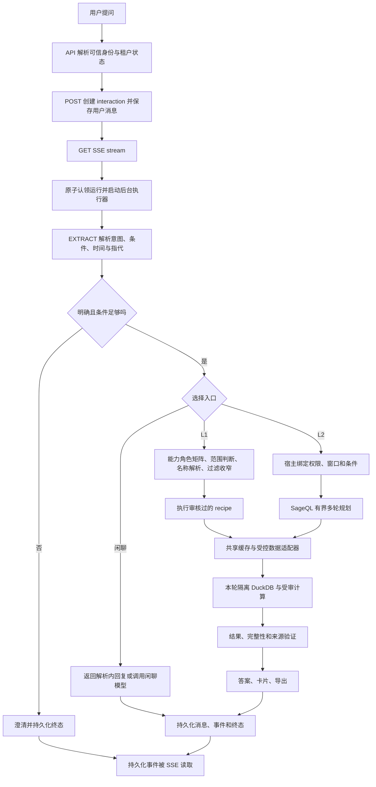
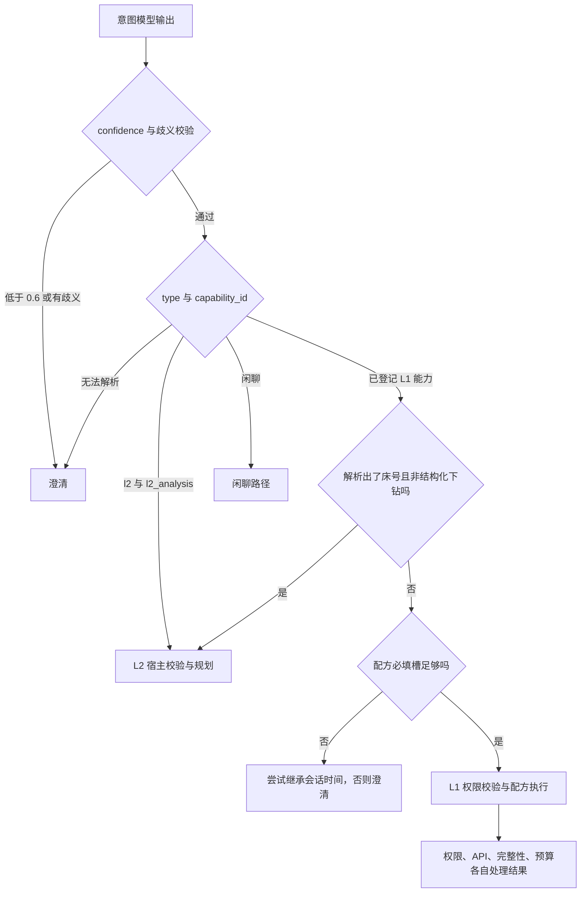
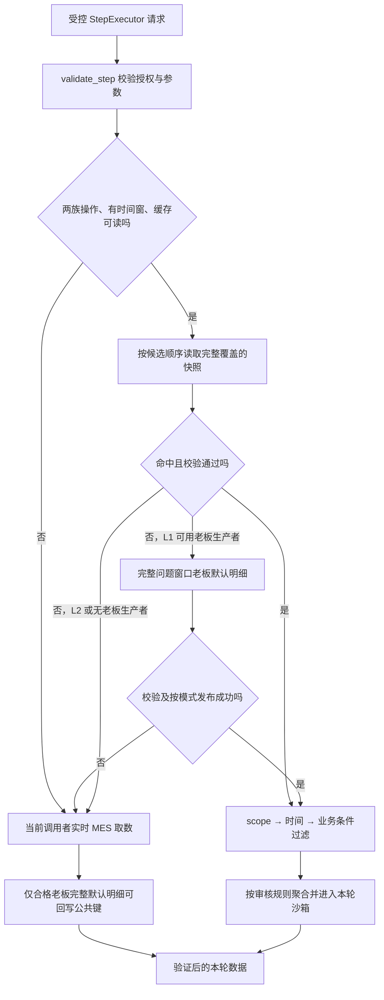
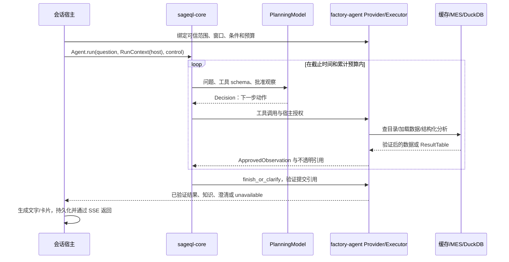

# 智能体问答流程与问题排查指南

本文回答：用户提出一个问题后，当前代码怎样得到答案；API 与缓存如何配合；怎样选择 L1/L2；
SageQL 实际能处理什么；字典问题为什么可能答不好；慢在哪里看，以及应从哪些文件定位。

核对日期：2026-10-15。factory-agent 基线提交：`4d2afde`；SageQL 同时核对
`C:\codes\sageql` 的当前工作区和 factory-agent 锁定的 wheel。路径、函数和默认值描述的是
本次核对的实现，运行实例的环境覆盖值、数据规模和耗时需要另行核实。

本文是现状和排查说明，不新增业务口径、权限或接口承诺。口径依据仍是
[产品需求](../product/需求及方案整理.md)、[MES 接口契约](../product/AI问答对外接口-整理.md)
及已接受 ADR；L2 对接见 [L2 自主分析契约](../api/L2自主分析契约.md)。
未读取生产凭据、未访问客户环境，也未检查第三方前端子模块。

## 1. 先看这几个结论

| 现象或疑问 | 当前实现结论 | 直接影响 |
| --- | --- | --- |
| FR1～FR13 相对稳定 | L1 使用已审核的固定配方、SQL、指标及卡片 | 固定场景的计算和展示比较确定 |
| API 里有数据，为什么不一定答得出 | 还要经过逻辑数据集登记、安全投影、关系证明、计算支持、规划和答案组织 | 不能只通过接口文档判断问答覆盖率 |
| L1 失败会转 L2 吗 | 主要在意图解析阶段选择；不是通用失败重试机制 | 权限、接口、完整性或预算失败不会自动由 L2 解决 |
| V1 字典文档是否已完整进入模型 | 没有。当前知识是 6 条审核片段，数据是固定的 11 个逻辑数据集 | 任意字段解释、任意 V1 API 问题尚无完整知识覆盖 |
| 缓存是否保存了现成答案 | 两族业务缓存保存可复用的默认明细底料；字典保存安全配置投影 | 命中后仍要过滤、计算、组织答案 |
| Redis 命中为什么还慢 | 可能读取整个年度明细 JSON，再解码、校验、多轮过滤并计算 | 要看本地处理时间，不能只数 MES 请求 |
| trace 能否直接当精确瀑布图 | 已有多层观测，但有时间边界、关联和提交尾部的缺口 | 先核实观测可信度，再据此确定性能根因 |

下文将“源码已确认的事实”与“需要实际失败样本或耗时数据确认的推测”分开。
本文发现的是明确的实现边界和排查线索，尚不能把它们全部认定为当前现场问题的根因。

## 2. 从一句问题到最终答案



关键时序如下。

1. `api/identity.py` 从可信凭据交换取得身份；业务路由先拒绝停用租户。认证调用与业务取数要
   分开统计，不能把“零业务 API 调用”理解成完全没有网络请求。
2. `api/sessions.py` 的 `start_interaction` 创建交互；`SessionService.start` 先授权、保存用户消息
   和 `PENDING` 记录。真正的问答执行由 stream 首次成功认领后启动。
3. `SessionService.stream` 用持久化 compare-and-set 认领，后台 `InteractionRunExecutor` 执行。
   SSE 连接读取已保存事件；重连回放不应重新执行一遍 MES 查询。连接断开与取消交互是不同动作。
4. `session/pipeline.py::_pipeline` 调用意图解析；多轮上下文来自本会话已终结的历史，解析可以
   产出 `rewrite_query`。结构化下钻直接构造确定性意图，不需要再次用模型选能力。
5. L1 在 `_authorize_request` 完成角色、范围和过滤校验后运行配方。员工/部门编号不接受模型
   自行填写；名称通过可信目录解析，条件只能收窄 `DataScope`。
6. L1 的 `KernelCapabilityRunner.run` 建立本轮 DuckDB，执行 API 步、注册验证后的表、运行配方
   计算、构造 `ResultTable`，随后关闭连接。L2 同样由宿主持有并关闭隔离沙箱。
7. L1 还检查结果与有效范围的一致性。`_complete_result` 组织答复和卡片、尝试导出，再保存结果
   消息、`interaction.result` 和终态；导出失败不把有效业务结果变成失败。

### L1 的“回答得好”由哪些东西共同决定

`configs/knowledge/recipes/` 里的配方给出固定取数与计算：

| 场景 | 当前来源与主要加工 | 配方位置 |
| --- | --- | --- |
| FR-001～003 本人产量、工资和明细 | V2 工资产量默认明细，绑定本人后聚合 | `output.yaml`、`wage.yaml` |
| FR-004/008 排名与工资清单 | 完整获准人群先聚合；本人排名最后取本人 | `payroll-list.yaml` |
| FR-005/009 进度与下钻 | V2 进度；缓存由默认明细派生视图，实时也可使用 MES 原生分组，缺必要维度时有界回退默认明细 | `progress.yaml` |
| FR-006 订单/款号产量 | 工资产量贡献、参与人数及进度分母按规则加工 | `order-output.yaml` |
| FR-007/010 部门产量、对比 | 获准部门内聚合、去重人数和人均量 | `workshop.yaml` |
| FR-011/012 全厂工资、指定员工工资 | 共同工资明细；名册分母或目标员工校验 | `payroll-list.yaml` |
| FR-013 全厂总览 | 两族明细与安全名册，日序列和部门指标 | `dashboard.yaml` |

能力映射以 `application/capability_map.py` 和实际 recipe 的 `capability_id` 为准。
当前产品文档顶部的 V2 口径优先于旧 V1 取数示意；不要从历史设计图推导运行调用链。

L1 文本答复由 `application/summary.py::ResultSummarizer` 根据**结果元数据和合计**生成，
不把逐行明细交给模型；失败则返回确定性摘要。其提示要求不超过 120 字，通常引导查看卡片。
所以排查“答得不好”时要区分：选错能力、计算不对、卡片缺内容，还是摘要表达不足。

## 3. L1 与 L2 究竟怎样判断



实现上，床号强制改路由发生在通用澄清检查之前；图中把模型置信度单列是为了说明校验目的。
强制改路由不会消除原有 `ambiguous` 标记。

- `application/intent.py::L2_ROUTING_PROMPT` 告诉模型：固定能力无法完整表达的筛选、分组、趋势、
  多源配置或字段知识问题选 L2；可完整表达的仍选 L1。字典问题不强制事实时间窗口。
- `CapabilityIntentParser.interpret` 仅在 `type="l2"` 且 `capability_id="l2_analysis"` 时按 L2
  解释。置信度阈值默认 `0.6`；非法范围槽位、歧义会使请求澄清。
- `session/pipeline.py::_pipeline` 有床号补强：非下钻请求、已解析床号且已有非空能力时，改为 L2。
  床号按原字符串保留前导零。这个条件依赖模型先把床号正确抽到 `bed_codes`。
- 其余长尾是否超出 L1，主要依赖模型判断；当前没有一个通用的“问题全部条件都被该配方覆盖”
  校验器。不能根据路由提示词就断言模型永远不会把复杂问题套进 L1。
- L1 必填槽来自 `capability_map.py::REQUIRED_SLOTS_BY_FR`，通常是时间，指定员工工资另需姓名。
  无时间的省略追问可继承本会话窗口。L2 的配置/知识请求不套用这套 L1 时间必填规则。
- 权限拒绝、源接口失败、未知口径、无完整来源、超时和预算耗尽都不是通用 L1→L2 的触发条件。

**定位建议：**先核对最终 `capability_id`、改写问题和抽取条件，再查数据。发现“字典问题被要求
补月份”时，优先检查是否误选了 L1，或上下文改写是否混入上一轮事实查询。不要先改 API。

## 4. API 与缓存：实际分成三层

| 层 | 保存内容 | 生命周期与实现 |
| --- | --- | --- |
| `v2_result` | 工资产量、生产进度两族老板完整默认明细底料 | 跨交互 Redis；`data_api/result_cache.py` |
| `identity_org` | 部门/员工安全名册、V1 字典及配置安全投影 | 跨交互 Redis，24 小时；`application/cache.py`、`data_api/knowledge_directory.py` |
| 本轮复用 | L2 已装载数据的句柄、相同查询及可覆盖的更窄查询 | 只在当前 interaction；`application/l2/provider.py` |

生产 `_build_cache` 只接 Redis；没配置 Redis 时为 `None`，没有自动启用的生产内存缓存。
`tests/support/cache.py::InMemoryCacheStore` 用于测试。缓存不决定 L1/L2 的路由。

`application/cache.py` 虽仍登记 `order_progress=120s`、`output=60s`、`payroll=60s`，当前两族
主路径实际走 `v2_result`，不能把那三个注册值当作当前业务明细的 TTL。

### 4.1 业务查询的命中、回源与回写



入口是 `ResultCacheExecutor.execute_full_step`，当前两族操作为 `GongziClQuery` 和 `ScjdQuery`。
其他 API 不因此获得同样的业务底料缓存。外部响应先由 `data_api/` 验证、规范化，范围外行在
进入该交互沙箱前过滤；公共缓存含更大授权底料，不代表调用者或模型获得该范围。

历史窗口优先探测今天对应的年度预取快照，再探测昨天且仍覆盖问题的快照，最后探测问题自身
完整窗口的回填键。**每份候选必须独立覆盖整个问题，不把多个窗口拼起来。**包含今天的问题也
不会把年度历史与实时今天拼成一个结果，而是使用同一个完整问题窗口。

冷 L1 可以同步调用独立老板生产者获取**完整问题窗口**，不是必然抓取全年；若获取后缓存发布
失败，仍可能再走调用者实时路径，额外调用会叠加。普通角色或收窄后的明细不能回填公共键。

L2 的 `CachedFactSource` 注入的是 L1 同一个缓存包装后的 `step_executor`，但设置
`allow_owner_snapshot=False`：可消费已有快照，冷态不另借老板身份同步补全厂快照。
若当前调用者本身就是老板、取得完整无收窄默认明细，仍可通过回写门禁惰性回填。

模式要分开看：`off` 绕过结果缓存；`read` 不写结果缓存，但 L1 冷态仍可能通过已授权老板生产者
获取本轮快照，校验通过后直接使用；`readwrite` 可读可写；`shadow` 命中后仍取实时并做对照。
上图“按模式发布”在 `read` 下不要求 Redis 写入，写模式下发布失败则可能回到调用者源。
L1 shadow 比较最终配方结果/卡片，不一致返回实时视图、驱逐实际命中坏键并告警。
shadow 是核对模式，不能当成普通热缓存性能样本。

### 4.2 Key 的规则

`application/cache.py::AuthAwareCache.build_key` 生成外层格式：

```text
fa:{contract}:{metric}:{data}:{tenant_sha256}:{scope_sig}:{domain}:{params_sha256}

当前两族公共默认明细通常为：
fa:mes-contract-v2:metric-registry-v1:mes-detail-v4:
   SHA256(tenant_id):owner-99:v2_result:SHA256(canonical_json(params))
```

上面分行为展示，实际是单个冒号分隔 key。租户和参数都摘要化；参数 JSON 用排序键和紧凑
分隔符规范化。版本改变会进入另一命名空间。日志记录的是整个 key 的 `key_digest`，不打印原 key。

业务底料参数包含 `api`、`grain="default-detail-v4"`、`dates`、`datee` 和语义参数。
`groupbyFields` 和排序不进入底料键；工资 `Type` 字符串去重排序。
默认预取工资语义是 `Flag="0", Type="0,1,2"`，进度是空语义参数；不同口径不能混用快照。
两族公共键用 `owner-99`，请求者角色和过滤条件在读取后约束，不能把子集写成公共全集。

字典使用 `identity_org/shared`，参数形如：

```json
{"dataset":"<family>","entity":"<实体或空串>","schema":1,"semantics":"safe-directory-v1"}
```

完整小目录和完整款号工序关系按租户共享；颜色/尺码表单按验证后的内部款号实体缓存，制单
工序按获准制单实体缓存。命名集合分别证明完整后才保存，实体子集不能冒充全厂完整目录。

### 4.3 TTL、定时刷新和启动预热

| 项目 | 代码默认值 | 含义 |
| --- | --- | --- |
| `result_cache_mode` | `readwrite` | 运行配置可覆盖 |
| `result_cache_backtrack_days` | 365 天 | 数据覆盖窗口，不是 Redis 保留期 |
| `result_cache_unsettled_ttl_seconds` | 90 秒 | 含今天的完整问题窗口 |
| `result_cache_settled_ttl_seconds` | 86400 秒 | 历史快照与回填 |
| `identity_org` TTL | 86400 秒 | 目录及字典安全投影 |
| `result_cache_prefetch_enabled` | `True` | 仍需满足依赖、授权和写模式条件 |
| `result_cache_prefetch_hour` | 工厂时区 02:00 | 稳定租户抖动默认 0～599 秒 |
| `result_cache_prefetch_poll_seconds` | 300 秒 | 失败后再次尝试的调度间隔 |
| `result_cache_prefetch_timeout_seconds` | 600 秒 | 单轮预取截止时间 |
| 预取 lease | 默认 630 秒 | `ceil(预取截止秒数)+30` |
| `result_cache_snapshot_max_rows` | 1000000 行 | 老板快照容量上限，分页上限仍生效 |

预取在 `api/server.py` lifespan 中启动，启动后先做一次后台 warmup，之后每日刷新
`[今天−365, 昨天]` 两族历史默认明细。需要 Redis、凭据交换、真实授权老板生产者和可写模式；
只有开关为真并不保证实际预热成功。两族按顺序取数，并非固定只有两次物理 HTTP。

跨副本用 Redis `SET NX EX` lease 和 token 比对释放。两族都成功发布才记录完成 marker；
凌晨前 warmup 与 daily marker 分开，避免启动预热把当日刷新跳过。严格原子 fencing 的限制见
[ADR-0010](../adr/0010-whole-tenant-detail-cache-and-scope-dispatch.md)。

TTL 从写入后自然过期，未见读取续期；字典按需加载，**不是上述年度预取任务逐日全量刷新**。
默认 Redis 连接/命令超时各 1 秒，异常按 miss 回源；多候选多次访问可能叠加，不能据此保证整轮
缓存故障开销只有 1 秒。

## 5. SageQL 怎样处理 L2

### 5.1 实际接入的是哪个 SageQL

factory-agent 的 `pyproject.toml` 和 `uv.lock` 固定使用：

```text
vendor/wheels/sageql_core-0.1.0-py3-none-any.whl
```

它不是直接 import `C:\codes\sageql` 工作区，也不是启动 Vanna Web/SQL Agent 服务。
实际源码对应 `C:\codes\sageql\packages\sageql-core\src\sageql_core\`，不是把
`src/vanna/core/agent/agent.py` 当作本项目 L2 入口。

本次核对 wheel、已安装包与本地 core 的 6 个 Python 模块内容一致；wheel SHA-256 为
`845880220c310d1cafafa7152a289c28af3a0ed4232bd605d5540387da2f4e67`。
之后修改 SageQL 源码仍需重新构建 wheel、更新项目依赖并安装，才会改变 factory-agent 行为。
仅看版本号 `0.1.0` 不足以确认二者同步，应同时比较 wheel 摘要和安装来源。

### 5.2 多轮分析循环与双方分工



| 组件 | 负责什么 | 不会自动完成什么 |
| --- | --- | --- |
| SageQL `agent.py` / `control.py` | 观察驱动规划、动作循环、预算、一次语义修复、重复动作检测、取消和超时 | 不自带 MES 接口和业务口径，不执行 SQL，不决定角色权限 |
| SageQL `tools.py` / `models.py` | 结构化工具协议、查询、分析计划和提交引用 | 不替宿主证明数据关系及题意覆盖 |
| `application/l2/model.py` | 把规划请求送到 `llm_fast_alias`，默认使用 fast 逻辑别名 | 没有独立的“更强 L2 模型”默认选择 |
| `application/l2/provider.py` | 数据集发现、加载、观察、句柄复用、实体与范围约束 | 不允许模型任意选 HTTP 地址或绕过范围 |
| `execution/analysis.py` | 受审指标/关系验证、编译本地分析和结果提交 | 不允许任意公式、Python 或无限制 SQL |
| `application/l2/service.py` | 组装 core、转换结果、生成答案和计量 | 不把模型随手写出的业务数字当作证据 |

工具包括 `discover_datasets`、`describe_dataset`、`lookup_knowledge`、`ensure_dataset`、`inspect_dataset`、
`analyze_dataset`、`finish_or_clarify`。每次操作仍由宿主授权，数据和结果只通过本轮引用关联。
事实条件沿用宿主窗口和已收窄条件，模型不能扩大范围。制单配置必须从本轮获准进度视图解析
真实制单；款号表单必须先解析可信款号实体，不能仅相信用户给的内部编号。

### 5.3 “API 有，但答不好”的具体断点

当前可发现目录是 `ports/analysis_catalogue.py::DATASETS` 的 **11 个集合**：

| 类别 | 数据集 |
| --- | --- |
| V2 事实 | `reported_production`、`production_progress` |
| V1 字典/配置 | `styles`、`style_types`、`production_types`、`processes`、`style_processes`、`style_colors`、`style_sizes`、`bill_processes`、`hanging_lines` |

`discover_datasets` 当前忽略 `goal` 的检索含义，返回获准固定目录。接口文档的全部 API 不会自动
成为工具，也不会因为 Redis 内有数据就自动出现在目录中。

需要逐层检查：

| 层 | 当前已确认边界 | 典型表现与定位文件 |
| --- | --- | --- |
| 知识覆盖 | `ReviewedKnowledgeProvider` 只检索 6 条 `KNOWLEDGE`，按床号、报工、产量、制单、工序、车种、类型、配置、尺码、权限等 10 个词做子串匹配；无匹配返回全部片段 | 任意字段解释缺依据或返回泛泛说明；`l2/service.py`、`ports/analysis_catalogue.py` |
| 文档接入 | `configs/knowledge/field-dictionary.yaml` 没有被当前生产 L2 加载为知识库；知识片段的 `source` 只是出处标记，不会读取该整份文档 | 改文档/YAML 后问答没有随之变好；查实际 loader 和 `KNOWLEDGE` |
| 取数覆盖 | 只有登记数据集及其安全字段；字段不在投影中就无法查询 | API 响应有字段，L2 不认；`data_api/knowledge_directory.py`、`analysis_catalogue.py` |
| 实体关系 | 稳定键、实体归属、完整性与实际基数必须证明；未启用未经确认的两事实族关联 | 制单/床号关联失败或明确不可用；`l2/provider.py`、`execution/analysis.py` |
| 计算能力 | 宿主 Query 筛选首期只接 `eq/in`；分析聚合只支持审核字段上的 `sum/count/count_distinct` | 比率、均值、同比环比、窗口排名等不能因为 L1 有就推断 L2 也有；`execution/analysis.py` |
| 模型观察 | `ApprovedObservation` 提供目录、引用、列/行数、完整性等状态，不含真实数据行 | 模型无法浏览实际字典值后再自由推理；`l2/provider.py`、SageQL `models.py` |
| 终结校验 | 验证本轮知识/结果引用有效；没有通用的“证据是否完整回答全部题意”验收器 | 安全、合法的结果仍可能维度不对或答非所问；`execution/analysis.py::validate_submission` |
| 答案表达 | 知识路径拼接所选片段；数据路径 `_answer` 固定输出范围、行数、窗口、totals、warnings，不总结真实列表行 | 卡片有内容但正文只说“返回 N 行”；`l2/service.py::_answer` |

普通趋势并非完全不支持：`AnalysisPlan.time_bucket` 可按 `day/week/month` 对受审指标分桶。
缺少的是通用派生公式。指标字段本身也受每个数据集的 `metrics` 限定，例如 `processes` 仅登记
`process_id`，不能据此要求对任意车种或工段字段计算去重数。

字典的 family 完整性也是独立关卡：款号与类型、款号表单与颜色/尺码分别组成命名集合，任一
集合不完整、稳定 ID 重复或关系冲突，都可能使整族加载不可用，即便本题只询问其中一个集合。
这与 API 返回零行、模型不会调用工具是不同原因。实体配置一次最多 20 个实体，不能当无限批量接口。

这些边界要分别解决。仅加一句“你可以查询字典”的提示词，不能补齐未登记的数据、缺失知识、
未实现的指标或答案表达。也不应直接把原始 API 响应交给模型以绕过现有隐私边界。

### 5.4 把字典问题分成三类再复现

以下问题都是合成例子，不代表客户真实配置。

| 问题 | 应走的证据 | 首先检查什么 |
| --- | --- | --- |
| “生产类型和工序有什么区别？” | 已审核知识，不需要业务取数 | 路由 L2、知识片段是否覆盖所问概念、返回的引用是否贴题 |
| “我们厂有哪些生产类型，分别叫什么？” | 当前租户 `production_types` 完整字典及结果表 | 是否误用知识片段代替实际列表；是否只报行数；完整性是否通过 |
| “某款号配置了哪些尺码/工序，停用的算不算？” | 验证后的款号实体、`style_sizes/style_processes` 配置 | 实体解析、配置全集与使用状态、配置记录数和去重种类数是否分清 |

“本月报过工的工序”只能由本月事实回答，不能冒充“该款全部配置工序”；同样不能从事实里
出现过的尺码补成完整尺码字典。床号到制单配置还依赖真实进度窗口和可见范围。

## 6. 慢问题怎样拆开定位

先分 **实时、冷缓存、普通热缓存、shadow** 四种条件，再比较同角色、同问题、同窗口的耗时。
L1/L2 和纯知识/字典/事实请求也应分别统计。第二次变快或变慢不能单独证明缓存正确或无效。

| 路段 | 源码中确实存在的成本 | 要看什么证据 |
| --- | --- | --- |
| 身份与名称解析 | token 换取/续期，目录未热，名称歧义；发生在事实取数前 | 请求入口、身份耗时、目录调用，不只看主 MES 事实 API |
| 意图/规划 | 初始 EXTRACT；可能的范围模型；L2 多轮 PLAN/REPAIR | LLM 次数、阶段、token 和时长，不能把多个模型回合视为一个调用 |
| 热业务缓存 | 整个年度 Redis JSON 解码、逐行重建 dict、日期/字段验证、派生、多轮 Python 过滤和聚合 | `cache.decode/validate/derive/scope_filter/time_filter/business_filter/aggregate` 的行数与耗时 |
| 冷 L1 | 同键等待、独立老板生产者锁、获取快照、发布；失败后可能再回调用者源 | `cache.lock_wait/produce/publish/realtime/write_gate` |
| MES 分页 | 顺序翻页；先探测，必要时放大 page size 并从第 1 页重走；重试也花时间 | 实际页数、请求次数、page size、重试与完整性原因 |
| 本地计算 | 表注册、类型转换、过滤、SQL、结果序列化；L1 API 步按配方顺序 await，fan-out 才有有界并发 | `duckdb.*`，区分独立步骤和并发子请求 |
| 答案之后 | 摘要、导出、业务提交、计量和调试写入、SSE 读取尾部 | 结果完成时间与客户端收到终态的差额 |

DuckDB 注册优先尝试 bulk JSON，但类型不支持或批量加载失败时会退回逐行 `execute`。
查 `execution/sandbox_runtime.py::register_table/_register_rows_bulk/_register_rows_per_row`，
并读取 `duckdb.register` 的 `input_rows/output_rows`、`load_method`、`bulk_attempted`、
`fallback_reason`，可区分正常批量加载和大行数逐行退化。

缓存热态存在一个可直接定位的优化点：`result_cache.py::scope_filtered_rows` 在逐行 `keep(row)`
内重复构造部门/员工字符串集合；是否值得先改应由大行数样本测量决定。更大的成本可能来自
年度 blob 解码和过滤，不能凭这一处代码就确定主要瓶颈。

主要默认边界来自 `config.py`：MES 单请求 30 秒、初始每页 20000、放大上限 50000、最多 20 页；
交互运行截止 300 秒、SSE follow 最长 600 秒、LLM 默认单调用 30 秒。分页、请求、处理行数、
模型回合和 token 另有累计预算；超时上限是保护边界，不是可接受响应速度。

L2 继承同一交互控制器并进一步收紧预算；初始解析和此前修复也计入，不是进 L2 后重新获得一套
额度。预取的 600 秒和 100 万行预算不能被 L2 借用。改某个超时并不能消除串行调用或重复处理。

factory-agent 接入 L2 后的主要默认预算如下，实际消耗还包括前序解析。

| 资源 | 默认边界 |
| --- | --- |
| 模型累计回合 / 工具步数 | 12 / 16 |
| MES 累计 requests / pages | 20 / 20 |
| 累计处理行 / 分析次数 | 250000 / 6 |
| 模型累计 token / 结果累计字节 | 30000 / 1 MiB |
| 全交互语义修复 | 至多 1 次 |
| core 并发调用上限 | 1 |
| `Query.limit` | 默认 250000，schema 最高 1000000，不能突破累计预算 |
| `AnalysisPlan.limit` | 默认 1000，最高 10000；结果超限标记 incomplete，不自动翻页取全 |

`processed_rows` 不是唯一记录数：载入和每次分析扫描都会累计。例如载入 150000 行，再做一次
全表分析是累计 300000 行，已超过默认 250000；缓存热也可能遇到这个限制。

SageQL 每轮重发全部历史 observations 和全部工具 schema；数据发现还返回完整获准目录。
因此多轮工具越多，请求体和 token 也可能增长。是否是现场主因仍需对比模型阶段耗时与 token。

## 7. 当前 trace 怎么看，哪些地方还不够准确

### 7.1 两个观测通道

| 通道 | 数据来源与开关 | 能回答什么 |
| --- | --- | --- |
| A：结构化计量事实 | 常规 LLM/MES/交互事实，业务提交后单独事务写入 | 路由、调用阶段、时长、次数、token、结果状态 |
| B：调试捕获及本地 span | 仅开发环境允许开启，`debug_trace_enabled=False` 为默认值 | 缓存、本地 DuckDB 等更细时间线，以及经策略处理的调试内容 |

`interaction.progress` 和 `interaction.thinking` 是用户进度事件；后者主要是审核过的固定文案及
计数，**不是模型隐藏推理，也不是完整性能 trace**。B 关闭时没有本地 span，不能据此说本地
计算花了零秒；调试捕获有行数/字节上限和脱敏，缺少原始内容也是正常的策略结果。

trace 从持久化记录拼装，并非 SSE 自带一份完整内存调用栈。入口在 `api/trace.py`，读取逻辑在
`application/trace.py`，存储在 `persistence/trace_store.py`、`debug_trace_store.py`，报告生成在
`application/trace_report.py`。业务读取仍要求当前身份拥有该 interaction。

按顺序使用这些后端端点：

1. `GET /v1/trace/capabilities`：确认当前环境实际可捕获什么。
2. `GET /v1/interactions/{interaction_id}/trace`：结构化时间线与汇总。
3. `GET /v1/interactions/{interaction_id}/trace.html`：开发报告；仅 local/dev 且开启捕获时注册，
   下载还需要成功记录审计。

HTTP 的 `X-Request-ID` 用于单次请求关联。trace JSON 的 `request_id` 来自读取 trace 的这次 GET，
不能把它当作原始问答 POST 的 request ID。B 通道默认可读保留期为 24 小时，单载荷最多
262144 字节/500 行；过期内容读取时不可见，物理清理当前只在启动执行一次，并非定时准点删除。

### 7.2 读耗时时的规则

同一次交互优先用 **`interaction_id`** 串联，结合 `session_id`、具体调用/本地 span 标识。
并发子请求的 MES/LLM 时长加总是资源耗时，不能直接当作墙钟耗时；父子 span 也会重复覆盖。
trace 中 `processing_summary.timing` 的 exclusive、overlap、uncovered 更适合判断时间覆盖，
仍需结合下面已发现的时间边界问题解释。

`ledger.local_ms=max(0,total_ms−MES调用时长之和−LLM调用时长之和)` 是残差，包含等待、排队及
未观测工作，并非纯 CPU；并发累加超过墙钟时会被截为 0，不能由 `local_ms=0` 断言本地计算快。
顶层 `total_ms` 是时间轴长度，可扩到最晚 span 结束；`ledger.total_ms` 来自交互完成事实，
两者可能不同。SSE phase/progress 的 `duration_ms` 也是自运行开始的累计值，不是该阶段独占耗时。

### 7.3 源码已确认、建议优先修复的观测问题

| 问题 | 代码证据 | 对排查的影响 |
| --- | --- | --- |
| 一个交互不保证一个 usage `trace_id` | `session/base.py::_usage_context` 每次调用 `new_trace_id()`；`service.start` 也另建 ID | 按单个 trace_id 聚合可能漏调用；当前应以 interaction_id 为主 |
| 部分 L1 LLM 瀑布时间边界前移 | `_parse/_chat/_compose_result_answer` 及 `session/consistency.py` 在调用前取 `now`，结束后仍传作 `occurred_at`；`usage.py::_resolve_span_edges` 默认把它视作结束时刻再减 duration | duration 可能有值，但柱子的开始/结束位置不准确，影响 uncovered/overlap 解释；L2 `model.py` 在调用返回后取时钟 |
| start 阶段目录 MES 计量可能丢失 | `SessionService.start` 授权后 `set_usage_context(None)` 清缓冲，首次 commit 只提交 started 事件，没有 drain 该段 MES buffer | 初始授权/目录成本可能不在交互 trace 的 MES 列表中 |
| 提交尾部存在观测盲区 | 终态 duration 在最终持久化前形成；业务提交后仍 await 计量和调试事务，再通知订阅者 | “业务已经完成”与“客户端已收到终态”可能有差额，现有 duration 不完整包含最终提交尾部 |
| L2 完整动作轨迹没有落入 trace | `InteractionEventSink.emit` 只转发 phase；生成的 `analysis_completed` 累计计数没有被 `SqlTraceStore.load` 读取 | 公开 trace 可看到调用和底层操作，但不能完整还原每个工具决策、观察和验证；更细内容需获准开发捕获或补安全观测 |

上述是静态代码能够证明的实现问题/风险，不是本次在客户环境测得的耗时。
不同事务只隔离失败回滚；当前代码仍 await 计量/调试持久化，不能据此声称它们没有响应延迟影响。
修复观测时应保持失败不回滚业务答案的边界。

## 8. 按症状选择文件，不要一次改完整条链路

| 症状 | 首查位置 | 接着确认 |
| --- | --- | --- |
| 选错能力、字典问法落 L1、复杂条件被丢 | `application/intent.py`，`application/session/pipeline.py::_pipeline` | capability、rewrite、床号/时间/实体槽，是否存在配方覆盖不足 |
| 某 API/字段完全无法用 | `ports/analysis_catalogue.py`，`data_api/catalog.py`，`data_api/knowledge_directory.py` | 是逻辑目录未登记、安全投影没保留，还是接口契约未实现 |
| 任意字段解释答不出 | `ports/analysis_catalogue.py::KNOWLEDGE`，`application/l2/service.py::ReviewedKnowledgeProvider` | 知识覆盖、匹配和引用，不能只改 field-dictionary.yaml |
| 卡片有数据，正文只说行数 | `application/l2/service.py::_answer`；L1 则看 `application/summary.py` | 正文策略与表格内容分别验收 |
| L2 算不了比例、同比/环比等派生指标 | `execution/analysis.py`，`ports/analysis_catalogue.py::DATASETS` | 普通时间分桶趋势已有支持；受审 metric、聚合/关联是否真的支持所问公式 |
| 缓存一直 miss、冷热没区别 | `data_api/result_cache.py`，`bootstrap.py::_build_cache` | 运行 mode、Redis、版本、窗口、口径、老板生产者和拒写原因 |
| 预热没启动或每天未刷新 | `application/prefetch.py`，`data_api/owner_snapshots.py`，`api/server.py` | 依赖条件、真实老板授权、lease、完成 marker、完整性和预算 |
| Redis hit 但慢 | `result_cache.py::_decode_result_set/_project_rows/scope_filtered_rows` | blob 行数、decode/validate/filter/aggregate 分项耗时 |
| L2 重复加载或工具绕圈 | `application/l2/provider.py`，SageQL `agent.py/control.py` | 相同/覆盖请求句柄、观察状态、重复动作、剩余预算 |
| 制单工序或款号配置失败 | `knowledge_directory.py`，`application/l2/provider.py` | 实体来源、稳定键、命名集合 total、状态字段和关联基数 |
| API 总体慢、页数多 | `data_api/pagination.py`，`data_api/hongzhao.py`，`config.py` | 探测重走、分页上限、重试、API 实际响应大小 |
| trace 看起来缺调用/时间错位 | `session/base.py`，`session/service.py`，`session/pipeline.py`，`application/usage.py` | 本文 §7 的关联、开始/结束和缓冲清理问题 |
| 结果已算好，终态回来慢 | `session/pipeline.py::_complete_result`，`persistence/session_store.py::commit`，`session/base.py::_commit` | 导出、最终业务/计量/debug 提交和事件通知；其他终态另看 `session/outcomes.py` |

SageQL 本地源文件定位：

```text
C:\codes\sageql\packages\sageql-core\src\sageql_core\
  agent.py       Agent，规划与终结
  control.py     RunControl / RunLimits / BoundedController，预算、截止时间与循环
  tools.py       DataTools，工具分发与授权入口
  models.py      Query / AnalysisPlan / Decision / ApprovedObservation / Submission
  protocols.py   宿主注入接口
```

源码导航（以下链接相对本文，函数名用于在文件内搜索）：

| 关注点 | 源码入口 |
| --- | --- |
| 运行接线与配置 | [bootstrap.py](../../src/factory_agent/bootstrap.py)、[config.py](../../src/factory_agent/config.py) |
| 身份与问答 API | [identity.py](../../src/factory_agent/api/identity.py)、[sessions.py](../../src/factory_agent/api/sessions.py) |
| 意图与 L1 配方 | [intent.py](../../src/factory_agent/application/intent.py)、[capability_map.py](../../src/factory_agent/application/capability_map.py)、[recipes](../../configs/knowledge/recipes) |
| 会话与提交尾部 | [pipeline.py](../../src/factory_agent/application/session/pipeline.py)、[base.py](../../src/factory_agent/application/session/base.py)、[service.py](../../src/factory_agent/application/session/service.py)、[session_store.py](../../src/factory_agent/persistence/session_store.py) |
| 缓存 key、预热与后端 | [cache.py](../../src/factory_agent/application/cache.py)、[prefetch.py](../../src/factory_agent/application/prefetch.py)、[Redis 实现](../../src/factory_agent/infrastructure/cache.py) |
| 业务明细缓存与生产者 | [result_cache.py](../../src/factory_agent/data_api/result_cache.py)、[owner_snapshots.py](../../src/factory_agent/data_api/owner_snapshots.py) |
| MES 分页、字典与事实投影 | [pagination.py](../../src/factory_agent/data_api/pagination.py)、[hongzhao.py](../../src/factory_agent/data_api/hongzhao.py)、[knowledge_directory.py](../../src/factory_agent/data_api/knowledge_directory.py)、[analysis_source.py](../../src/factory_agent/data_api/analysis_source.py) |
| L2 宿主 | [service.py](../../src/factory_agent/application/l2/service.py)、[provider.py](../../src/factory_agent/application/l2/provider.py)、[model.py](../../src/factory_agent/application/l2/model.py) |
| L2 语义目录与计算 | [analysis_catalogue.py](../../src/factory_agent/ports/analysis_catalogue.py)、[analysis.py](../../src/factory_agent/execution/analysis.py)、[sandbox_runtime.py](../../src/factory_agent/execution/sandbox_runtime.py) |
| trace 采集与读取 | [local_trace.py](../../src/factory_agent/observability/local_trace.py)、[debug_trace.py](../../src/factory_agent/observability/debug_trace.py)、[usage.py](../../src/factory_agent/application/usage.py)、[trace.py](../../src/factory_agent/application/trace.py)、[trace_store.py](../../src/factory_agent/persistence/trace_store.py) |

## 9. 一次有效的排查应该留下哪些证据

### 9.1 单个失败问题

1. 保存经过脱敏的原问题与预期回答，注明是知识、真实字典、配置、事实统计还是多源问题。
2. 保存角色、请求时间、工厂时区、事实窗口、`interaction_id`；不保存凭据或无关身份信息。
3. 先检查路由和条件：是否误选 L1/闲聊，是否被要求不必要的时间，是否遗失关键实体或状态。
4. 若为 L2，按发现→知识/数据加载→分析→提交逐步核查：是否选对数据、观察是否完整、工具返回
   unavailable 还是模型没使用已有来源。仅看最终“无法可靠提交”不足以区分原因。
5. 分别核对结果表和正文。表里有正确列表但正文没说，定位答案组织；源数据就没装载，定位
   数据目录/实体/缓存；已装载却维度不对，定位计划及题意覆盖。
6. 将问题加入回归样本，验收预期路由、来源、筛选、结果和正文；脚本能跑完不等于语义答对。

### 9.2 单个慢问题

记录四个时间点：客户端提交、首个有效进度、结果计算结束、收到终态。结合后端 trace 统计
模型回合、实际 MES 请求/页数、缓存来源、载入与扫描行数；每次比较保持问题、角色和窗口一致。
优先看最大的已确认耗时段，并单独测最终提交尾部；不要直接把所有 span 时长相加。

### 9.3 已有工具及其副作用

下列入口供获准测试环境定位使用，本次没有执行在线诊断，也没有修改缓存或部署。
运行时配置可能来自 `.env`；不要在文档或报告中粘贴其值。

| 入口 | 做什么 | 注意的实际动作 |
| --- | --- | --- |
| `scripts/run_qa_batch.py` / `make qa` | 角色问题批跑、读 trace、分轮耗时与结果汇总 | 真正发起问答；需要模型及测试 MES，`--repeat 2` 可比较但不保证第二轮一定命中 |
| `scripts/verify_result_cache_read.py --window YYYY-MM-DD YYYY-MM-DD` | 检查现存问题窗口快照 | 不取业务明细、不写 Redis；身份初始化仍可能读 token/组织资料 |
| `scripts/diagnose_cache_prefill.py --reuse-fetch` | 检查现存快照可读性，不验证完整业务视图派生 | 同样可能初始化身份，不代表完全无网络 |
| `scripts/diagnose_cache_prefill.py --dry-run` | 取默认明细并验证 | 会取真实业务数据，只是不写 Redis |
| `scripts/diagnose_cache_prefill.py` | 取默认明细并写 Redis | 有缓存写入；`--only` 可限定一家族 |
| `python -m factory_agent.source_verification --test-environment --date YYYY-MM-DD` | 不调用模型的字典/事实源验证 | 会读测试 MES；`--dataset` 可限定集合，不能替代完整问答验收 |

合成 unit 测试入口：

```powershell
.\.venv\Scripts\python.exe -m pytest tests/unit/application/test_intent.py tests/unit/application/test_l2_session.py tests/unit/application/test_sage_analysis_runner.py tests/unit/data_api/test_result_cache.py tests/unit/data_api/test_directory_cache.py tests/unit/execution/test_analysis_host.py tests/unit/observability/test_local_trace.py -q -p no:cacheprovider --basetemp .cache/doc-flow-review-20261015
```

本次上述定向回归：**191 passed**。另可按模块选择
`test_l2_cache_trace.py`、`test_kernel_cache_trace.py`、`test_result_cache_trace.py`、
`test_prefetch.py`、`test_prefetch_cache_version.py`、`test_trace_read_model.py`。
这些证明合成数据下的实现行为，不证明真实模型面对不同字典问法的正确率，也不证明客户一年
数据量下的容量和性能。[集成验收记录](SageQL集成实现与验收记录.md) 保留了真实源验证的局限：
完整款号工序、非空进度、制单工序及跨接口关系等仍有未验证范围。

## 10. 建议的解决顺序

1. **先补准观测。**优先处理交互关联、L1 LLM 起止时间、授权阶段计量和提交尾部，得到可信的
   一条失败/慢问题时间线；保留租户隔离、脱敏和独立计量事务边界。
2. **建立少量真实问题的质量基线。**至少分别覆盖字段解释、租户真实列表、款号配置、床号事实、
   多源关系及 L1 固定报表；逐项核对路由、来源、计算、表格、正文。
3. **按失败层补能力。**知识不足补审核知识及检索；数据不足补受控目录/投影；指标不足补受审
   计算；正文不足改宿主基于验证结果的表达。不要把这些问题统一归给模型或缓存。
4. **依据耗时占比优化。**年度 JSON 解码/过滤、冷态重复回源、分页重走、模型回合和持久化尾部
   是不同改动点；先选占比最大的，再用相同样本验证。涉及权限、敏感字段、保留期、外连或部署
   等边界的变化仍按仓库规则单独评审。

与本指南配套的实现说明：

- [API 数据驱动的 SageQL 分析实现说明](API数据驱动的SageQL分析实现说明.md)
- [缓存优先的 SageQL 包集成与 L2 自主分析方案](缓存优先的SageQL包集成与L2自主分析方案.md)
- [V2 接口取数重构与缓存加速方案](V2接口取数重构与缓存加速方案.md)
- [全租户明细缓存与范围分派 ADR](../adr/0010-whole-tenant-detail-cache-and-scope-dispatch.md)
