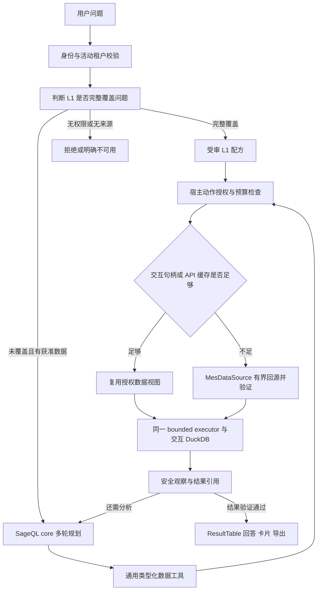

# 缓存优先的 SageQL 包集成与 L2 自主分析方案

> 状态：设计草案，待评审与实施。更新：2026-10-13。
>
> 方案遵循 `SECURITY.md`、现行产品和 V2 接口契约、ADR-0005、ADR-0007 与 ADR-0010。
> 本文提出包接口和接入方式，不声明相关能力、包拆分或客户环境验收已经完成。

## 1 目标与使用方式

保留现有 13 个产品能力作为 L1 确定性入口；当 L1 无法完整表达问题，而获准数据和已确认口径
可以支持时，进入 L2 多轮自主分析。L2 通过发现数据、观察安全状态、选择计算及必要补取来回答
长尾统计问题，不要求为每一种筛选与分组组合建立新的固定能力。

通用 Agent 能力和主要数据工具在 SageQL 仓库开发并形成可复用 Python 包，factory-agent
通过进程内依赖接入。SageQL 提供规划和工具框架，factory-agent 提供业务授权、缓存与 MES
数据接入、可信计算和结果交付。两个项目共享通用控制逻辑，不复制另一套 Agent 到业务仓库。

缓存是 L2 的主要数据来源。已有 API 明细包含多个维度，同一底料可以回答不同问题；换一个
床号、分组或统计粒度，不应重新请求 MES。正常路径先判断已有数据是否足够，在交互内复用
已授权数据，再读取持久 API 数据缓存，仅在完整性、覆盖或新鲜度不满足时受限回源。

需求方预期多数查询可以命中现有缓存，新增 API 请求较少。该预期指导取数设计；实际命中率、
回源比例和耗时由运行测量验证，不预设未经测量的百分比或固定性能收益。

## 2 当前能力与缺口

当前意图解析只能从固定能力目录选择一个 `capability_id`，未归类问题进入追问或失败。
执行内核按能力 ID 查找受审 recipe，尚无根据工具观察结果继续规划的动态入口。
`ARCHITECTURE.md` 已规定 L1 和有界 L2 共用执行边界，L2 的实际控制流程需要补齐。

床号示例的字段已经存在于工资产量和生产进度默认明细，但当前业务槽位、`NarrowedFilters`
和缓存视图未贯通床号筛选。这属于表达与执行缺口，不能认定客户数据只支持固定能力目录。

缓存也不是新建系统：`ResultCacheExecutor` 已封装缓存优先、完整明细读取、范围派发、视图派生、
回源与影子校验；`V2ResultCache` 管理两族底料；`CachedDirectorySource` 复用部门和员工目录。
L2 应接入这些路径并补齐通用查询契约，不另造一份持久缓存。

## 3 包的交付与兼容方式

### 3.1 独立轻量发行包

建议在 SageQL 仓库形成独立发行包 `sageql-core`，Python 导入名为 `sageql_core`；名称为
拟定公共契约，实施前核对发行渠道和命名可用性。可在 `packages/sageql-core/` 管理其构建配置，
以版本化 wheel 发布。factory-agent 安装该包，在同一进程中执行。

现有 SageQL 根项目发行名仍为 `vanna`，基础依赖包含 pandas、Plotly、SQLAlchemy、requests
等，顶层导入还连接 UI、评估和 integrations。仅添加 `core` extra 不能消除这些基础依赖。
因此先建立独立的轻量包和无副作用入口，factory-agent 不直接依赖整个现有发行包。

core 的直接运行依赖以标准库和 Pydantic 为限；不默认安装数据库驱动、Redis、模型 SDK、
HTTP 客户端、可视化、Web 服务或文件执行工具。最低 Python 版本须与现有 SageQL 用户兼容，
并在 factory-agent 的 Python 3.12 基线上验证。保留原有 MIT 许可与应有版权说明。

### 3.2 共享实现与版本管理

在 SageQL 内抽取通用控制循环及工具协议。原有 SQL Agent 通过兼容适配层调用同一核心，
保留其既有公开入口和 SQL/UI 体验；core 不反向导入旧 `vanna` 包。过渡期间的兼容测试应防止
出现两个独立演进的多轮控制器。

开发时可以采用本地 editable 依赖联调；可交付验证必须安装真实构建的 wheel，验证不依赖
`C:\codes\sageql` 或 `PYTHONPATH`。部署锁定获准版本，使用 uv 更新依赖与锁文件，避免
运行时拉取未固定分支。无需新增 Git submodule、复制第三方源代码或独立 Agent 服务。

公共协议版本、发行版本及源码版本应可追溯；核对当前包元数据与 `__version__` 的一致性。
发行包包含 `py.typed` 与完整的公开类型边界，在仅安装 wheel 的 Python 3.12 环境进行严格
类型检查和轻量导入验证。新增正式依赖遵守仓库审批要求，本次仅记录设计，不修改依赖或部署。

## 4 SageQL 与 factory-agent 的职责

| 内容 | SageQL core | factory-agent |
|---|---|---|
| 多轮控制 | 动作校验、工具调度、观察反馈、终止、无进展检测 | 注入本次交互策略与生命周期 |
| 通用工具 | 数据发现、描述、载入、观察、分析、提交协议及通用实现 | 注入业务 Provider 和执行回调 |
| 数据契约 | 规范化 Query、DatasetDescriptor、分析计划、引用和安全观察模型 | 客户字段映射及业务口径注册 |
| 授权 | 每次动作强制经过宿主策略，不自行解释角色 | TenantContext、DataScope、既有 FR 角色矩阵及租户状态 |
| 数据访问 | 通过注入接口请求逻辑数据集 | 现有目录/API 缓存及 `MesDataSource`；MES HTTP 仅在 `data_api/` |
| 计算 | 结构化分析计划、通用语法校验和工具编排 | 业务规则校验、受控 SQL 编译及现有 bounded executor |
| 模型 | 提供可注入模型协议，保留安全动作历史 | 现有 ModelGateway、逻辑别名、LiteLLM、用量计量 |
| 存储与交付 | 短生命周期状态及结果引用 | 既有会话、ResultTable、SSE、卡片、导出和审计 |

主要工具可以在 SageQL 中实现为通用数据工具，其执行依赖注入的 `DatasetProvider`、
`AnalysisExecutor` 和 `ObservationPolicy`。MES 专用实现留在 factory-agent：core 不知道
客户地址、原始字段、凭据、Redis 键或 FR 编号，也不读取全厂缓存原始行。

core 不启动第二个数据库连接、不登记业务表、不保存业务会话或业务明细。已有 factory-agent
交互执行器继续持有唯一执行权、取消状态和整体 deadline。

## 5 公共契约

以下名称表示拟定接口，最终代码可调整命名，但须保留职责和安全边界。

| 契约 | 主要内容 | 强制约束 |
|---|---|---|
| `AgentModel` | 安全消息与工具 schema 输入，类型化 Decision 输出 | 不内置模型地址、凭据或 provider fallback |
| `DatasetProvider` | 发现数据集、描述可用数据、确保查询数据可用 | 逐次调用宿主授权和缓存解析；不让模型选择身份 |
| `AnalysisExecutor` | 接收数据引用及结构化分析计划，返回结果引用 | 只在宿主已授权沙箱中执行 |
| `ObservationPolicy` | 将内部执行状态转为 ApprovedObservation | 输出白名单；禁止自动序列化原始结果、metadata 或异常 |
| `RunControl` | 单调时钟 deadline、取消、共享预算、进展状态 | 工具动作与模型调用前后检查；结束后不继续执行 |
| `EventSink` | 规范化阶段、用量、完成或失败事件 | 宿主映射既有事件；不默认公开工具参数和内部错误 |

运行上下文携带不透明宿主引用，真实授权对象和凭据不进入可序列化模型上下文。
数据句柄绑定 interaction、当前身份与范围版本、查询限制、数据版本和来源快照；跨交互、
跨租户或未登记句柄一律拒绝，不能将上一轮发现的业务编号转换成新的授权范围。

core 的结果提交必须携带宿主认可的结果引用。模型直接输出的一段文字不能终结业务查询并
成为可信数值答案；最终结果验证、措辞生成和卡片/导出仍由 factory-agent 完成。

## 6 模型与事件接入

现有 factory-agent 的 `ModelGateway` 支持 system/user/assistant 消息和结构化 JSON，
尚未提供原生 tool-call 消息协议。首期通过宿主模型适配器将工具 schema 与安全观察编码为
结构化 Decision 请求，继续使用逻辑别名、现有验证与 LiteLLM 路由。

Decision 表达下一步动作、参数或提交/澄清状态，core 验证后执行。原生 function calling
可作为 SageQL 的另一种适配器，但不能成为 factory-agent 首期集成的隐含前提。
provider 网络重试和 fallback 继续由 LiteLLM 负责，语义修复沿用至多一次的应用约束。
为规划增加明确的 `ModelStage.PLAN` 及计量语义，规划与修复分别记录，不把规划伪装成
EXTRACT，也不能用 THINKING 展示流作业务决策。模型别名沿用获准配置。

Agent 阶段和调用用量通过宿主事件适配器进入现有交互与计量流程。SageQL 不登记另一套
聊天路由、不生成自己的一套前端事件，也不默认显示原始工具参数、异常、提示词或模型推理文本。
EventSink 只接收白名单状态和计数；展示事件与模型观察分开。非权威观测回调失败仅分类告警，
不阻塞业务答案、不改变授权或终态；宿主业务结果提交仍遵守既有持久化语义。

## 7 缓存数据集的发现与覆盖判断

### 7.1 复用已有 API 数据缓存

| 数据来源 | 当前已有缓存 | L2 用途与边界 |
|---|---|---|
| 工资产量默认明细 | `v2_result` 中获准老板底料 | 当前请求者范围内的报工、数量、工资等获准分析；不向模型开放敏感明细 |
| 生产进度默认明细 | `v2_result` 中获准老板底料 | 订单、制单、包与工序的获准进度分析，保留未扫码贡献 |
| 部门目录 | `identity_org` 安全投影 | 名称解析和获准维度关联，目录范围不代表业务数据范围 |
| 员工名册 | `identity_org` 安全投影 | 身份解析和已获准人数分母，由可信执行层使用 |
| 其它已登记 API | 不预设已存在可复用缓存 | 必须验证具体接入、粒度和权限；登记接口不等于已有可用底料 |

共享底料中的 Confidential 数据遵守已批准的缓存分类与保留规则；只有经过本次授权、查询
条件过滤后的行进入沙箱。安全名册投影也不等于允许把员工身份交给 LLM。

### 7.2 覆盖证据

数据集描述应让可信解析器判断“已有底料足以回答”，避免模型试探性反复取数。至少记录：

- 逻辑数据源、契约/数据/指标规则版本、默认明细或服务端聚合粒度。
- 可用规范化列、字段类型、所需字段验证状态、已确认指标与关联规则。
- 时间锚、工厂时区、完整覆盖窗口、生成时间和新鲜度规则。
- 影响语义的参数，如报工/审核口径及数据来源类型；不同参数不能混用。
- 完整性证据、来源行数、total/适用 footer 校验结果及降级原因。
- 内部范围派发依据与快照引用；对模型只返回批准的范围状态，不返回身份或键。

生成时间表示底料取得或加工时刻，不证明 MES 业务数据已更新到该时刻。进度底料的时间锚
使用 V2 响应的真实业务日期 `rq`，不能从制单编号推断。footer 缺失或不适用复算时记录未知，
不能报告对账通过；返回完整性由适用的 total、行数、预算和响应校验另行证明。

覆盖证据从已有缓存 envelope 和可信校验生成，不保存另一套可能漂移的长期缓存索引。
如需检索元信息，其有效性不得超过原数据，且只有原数据验证通过才报告可用。
缓存 envelope/派生规则升级按既有版本隔离，不硬编码旧版本为永久契约。

默认明细通常可支持更多筛选和分组；只含某个汇总维度的服务端结果不能倒推出床号或工序明细。
已查询某个床号得到零行，也不能证明完整底料没有覆盖其它床号；空的完整查询结果应被复用，
避免将真实空集持续当作 miss。

### 7.3 取数优先顺序

可信 `ensure_dataset(query)` 执行以下优先顺序，模型不需要指定 Redis 或 API：

1. 检查当前交互已载入的授权句柄。若范围、窗口、列、语义参数和版本足够，直接复用。
2. 使用已有 API 数据缓存解析器寻找满足完整覆盖和新鲜度的底料，验证后生成授权读取视图。
3. 仅在缓存缺失、过期、损坏、覆盖不足、粒度不足或字段验证失败时，执行有界回源。
4. 回源通过现有取数链，按同一授权和计算口径返回；符合既有条件才写回已有缓存。
5. 缺少数据源或确认口径时返回 unavailable，不能靠重新请求相同接口反复猜测。

历史窗口沿用当前完整年度底料、仍有效且完整覆盖的昨日底料、问题整窗底料的读取顺序。
包含今天的窗口沿用完整问题窗口策略，不把历史缓存与今天实时数据拼成未经验证的一份快照。
缓存不支持某项本地派生但接口有受审等价分组时，可受限回源；接口也不支持则明确不可用。

同一交互的同一数据请求合并执行，重复 ensure 不再次解码、装载或回源；并发相同请求复用
结果与完整性状态。跨交互继续沿用已有租约/预取机制，新增按需合并不扩大保留期。
持久条目的自然 TTL 到期不改变已取得短生命周期快照的内容；快照在取得时须有效，使用受
整体 deadline 约束并展示生成时间，不延长持久保留期。规则失效或 shadow 判坏须使关联句柄
失效；需要重新取得数据时替换相关数据集并重算依赖结果，不能混用旧结果。身份、角色或范围
版本改变时停止旧交互执行，不继续使用已载入句柄。两族各记录来源与生成时间，不声称客户
提供了跨 API 的事务一致快照。

## 8 L1 与 L2 的完整流程

L1 是能完整表达所有有效条件的确定性路径；不能因识别到“产量”就选择配方并丢掉床号。
L1 因表达能力不足进入 L2，而权限拒绝、数据缺失、接口失败、时间超限或预算耗尽不能被包装
成另一条无限重试路径。缺失必要条件仍追问，闲聊走原有分支。

如果在执行前已发现 L1 无法表达，应直接选择 L2，避免先调用 L1 再重复取数。确有 L1 预执行
状态需要交接时，只能转交当前交互内获准句柄和累计预算，不能把失败当作重置授权或预算的理由。

## 9 通用工具和分析能力

| 工具 | 通用行为 | factory-agent 注入内容 |
|---|---|---|
| `discover_datasets` | 按可执行目标发现数据集与缓存覆盖状态 | 当前获准语义目录与安全覆盖信息 |
| `describe_dataset` | 查看字段、日期、粒度、指标和关联限制 | 与现行 V2 规则一致的描述 |
| `ensure_dataset` | 确保所需列、窗口和条件的数据可用 | 交互复用、现有 API 缓存解析、必要 MES 回源 |
| `inspect_dataset` | 查看是否缺列、无匹配、不完整或还需补料 | 行数/覆盖/缺失状态及获准概要 |
| `analyze_dataset` | 校验结构化分析计划并调度执行 | 获准指标、受控编译、同一沙箱和 ResultTable |
| `finish_or_clarify` | 提交结果引用、追问或不可用结论 | 最终证据检查与既有交付流程 |

主要工具和参数 schema 在 SageQL 维护，API/cache 的业务实现通过 Provider 接入。
`ensure_dataset` 的返回值区分交互复用、持久缓存命中、实时回源、已证明空集、不完整和不可用；
Agent 因此可以依据数据是否足够继续规划，而不是把每轮动作都变成一次 API 请求。

分析计划首期支持获准维度筛选、分组、已确认合计、去重计数、趋势、排序和有界关联。
新组合可以复用已有指标，不允许模型自行定义未确认的业务公式。跨族关联先验证真实关联键、
基数、日期口径和覆盖，不能仅因两族都有订单号就做可能重复累加的 JOIN。

分析所需床号、日期和数量等字段必须单独验证。外部模型允许字段缺省以兼容动态分组，并不
证明本次计算具备完整字段；缺列、未知贡献、非法日期或 Decimal 解析失败不能补零。

## 10 床号上月产量示例

问题为“床号为 1555 的订单上个月产量多少”。默认解释为该床在上个月的报工产量，并在
结果中回显范围；若用户要该床关联的整张订单总量，明确差异并按需选择订单。

在工厂时区为 Asia/Shanghai、提问日期为 2026-10-13 的例子中，窗口为本地
`[2026-09-01 00:00, 2026-10-01 00:00)`。按既有订单产量权限校验后，查询工资产量的报工
时间口径和默认来源类型，先从授权历史底料切片床号。床号使用字符串等值语义，接口的模糊
匹配只作候选下推，不能混入 11555、15550，也不能猜测 01555 与 1555 等价。

如果缓存具备完整窗口、床号、计划号、报工日期和数量，ensure 直接返回授权句柄；按计划号
汇总、再按工序拆分或计算趋势均使用该句柄，新增 MES 业务请求为零。此问题无需先取生产
进度，因为进度按制单日期筛选会遗漏更早制单、上月发生报工的记录。

报工量按已确认数量贡献合计，明确“件·工序”，不当作独立成衣完工件数。同床多个订单分别
列示并给床号合计；空计划号保留“未关联计划号”；不扩大到相关订单的其它床号。
多工序和多员工贡献不能随意去重。完整窗口内无报工不等于床号或订单不存在。

缓存未满足覆盖时，由同一 Provider 请求完整问题窗口并验证，后续分析复用回源句柄。
目录冷态、token 换取/续期、必要业务回源及 shadow 校验分别计量，不能混称为热态零请求。

## 11 授权与数据安全

每个数据动作、指标和目标粒度映射到已有 FR 授权，复用既有角色矩阵；不能证明已获准的动作
保持不可用。员工个人分析不能成为整单或团队分析，工资排名等已有禁止语义也不能由组合计算
绕过。模型只提出业务条件，不能提供或替换 TenantContext、DataScope、凭据和授权 ID。

范围、时间及业务条件过滤在沙箱装载前完成。core 不接触公共全厂原始缓存；provider 内部可
复用底料，但返回交互句柄只能访问本轮获准视图。后续分析仍继承该问题条件，若要扩大用户
目标必须形成明确的新请求并重新校验，不能由 Agent 偷换范围。

ApprovedObservation 仅包含获准字段描述、覆盖和完整性状态、安全统计及不透明引用。
员工身份、个人报工/工资明细、单价、原始样本、客户错误内容和凭据不进入 LLM、日志、trace、
错误、事件或测试快照。core 默认不记录参数、提示词和原始工具结果，不自动学习保存业务数据。

分析通过宿主结构化计划编译及白名单校验，不直接执行模型自由 SQL。现有沙箱首词/关键字
检查服务于受审配方，不能原样作为自由 SQL 的完整防线。禁止多语句、DDL/DML、外部扫描、
文件、扩展、任意 Python 和 shell，并限制中间结果、扫描成本和执行资源。

缓存的 365 天回溯、历史 24 小时 TTL、包含今天窗口 90 秒 TTL 和目录保留规则沿用现有批准
方案。普通请求者的实时或床号子集不能回填公共老板底料键，不增加另一套缓存制度。

## 12 预算与交互生命周期

SageQL core 和宿主共享一个 RunControl。预算覆盖模型轮数、工具步骤、实际 MES 请求与页数、
累计处理行数、分析次数、模型 token、结果大小、并发、时间与内存。轮数不等于请求数，
同一工具内部分页或回源必须消耗同一累计请求预算，不按每个调用重置。

复用句柄不再次消耗上游请求预算，但每次分析仍消耗计算预算。普通问题沿用现有行数及整体
时长边界，年度预取的独立较大预算不能被 L2 借用。按请求摘要和进展状态识别重复动作，
同一错误不得循环修复，预算耗尽时只返回验证过的状态或获准部分，不伪造完整合计。

由既有 InteractionRunExecutor 保持唯一执行和终态提交。core 在模型和每个工具前后接受取消
与 deadline 检查，宿主对单次调用施加超时；单靠轮次之间检查不能收束卡住的 SQL 或网络调用。
SSE 断线仍不取消业务执行。结束、失败、取消或超时后关闭本交互 DuckDB 和短生命周期句柄，
不启动第二套后台任务、会话库或清理流程。

## 13 观测与验收指标

需区分“底料在缓存中”和“缓存足以回答整个问题”，也需区分 Redis 命中与交互句柄复用。
新增安全观测字段接入既有审计/计量，不另设跨服务用量传输：

- 问题级完整缓存覆盖数 / 可分析问题数，观察多少问题可以完全不回源。
- 交互句柄复用次数、持久 API 缓存命中次数和逻辑数据载入次数。
- 实际 MES 业务回源请求数及原因，包括 miss、过期、覆盖/粒度不足、损坏、规则不支持。
- 目录冷态请求、token 交换/续期及 shadow 请求单独记录。
- 规划轮数、工具和分析次数、模型消耗、冷热耗时、预算终止及无进展终止。
- 可回答、澄清、无来源、无权限、不完整、真实空集等结局的安全类别。

统计不记录客户行、身份或原始问题文本。以合成热态/冷态场景验证行为，再在获准环境测量
真实分布；shadow 不参与普通热态延迟或零业务调用的收益样本。

## 14 实施顺序与验收

### 14.1 SageQL 包建设

- [ ] 抽取轻量 core 和公共协议，核对包名、许可、版本、Python 兼容与发布方式。
- [ ] 将工具 schema、多轮控制、安全观察、预算、取消、无进展检测和规范化事件纳入 core。
- [ ] 实现通用数据工具，通过注入 Provider/Executor 执行 SQL 和 API 类数据访问。
- [ ] 原 SQL Agent 兼容层复用 core，保持既有公开入口；core 不导入 UI、provider 或数据库驱动。
- [ ] 构建并安装 wheel 验证，无源码目录依赖、隐式网络/文件操作或敏感默认日志。

### 14.2 factory-agent 接入

- [ ] 统一受审语义目录，记录并解决字段字典中 V1 残留与现行 V2 指标的冲突。
- [ ] 建立宿主 ModelGateway、DatasetProvider、AnalysisExecutor、ObservationPolicy 和事件适配。
- [ ] 接入两族 API 数据缓存和已有目录缓存，提供覆盖判断、授权视图和交互句柄复用。
- [ ] 贯通床号等首期维度，缓存与实时路径保持一致过滤及时间语义。
- [ ] 抽取并共用 L1/L2 bounded 执行核心，完成结构化计算、必需字段验证及 ResultTable 提交。
- [ ] 接入 L1 未完整覆盖的 L2 路由，保持拒绝、超限、无来源和接口故障的正确分流。
- [ ] 完成版本锁定、相关工程检查、契约文档及获准环境验收记录。

### 14.3 必须通过的用例

1. 床号上月报工与独立合成基准一致，床号近似值排除，前月制单上月报工不遗漏。
2. 缓存完整覆盖时，连续分组/趋势/工序分析真正复用同一数据句柄且零 MES 业务回源；完整
   空集也复用。同轮重复载入不重复读取、装载或请求，未请求的数据族不预取。
3. 缓存过期、损坏、列或覆盖不足时只补取必要数据源，并保留完整问题窗口；未确认指标直接
   unavailable，不反复请求 API。同一底料跨不同问题可命中，不按问题全文生成业务明细键。
4. 缓存与实时计算等价，Flag/来源类型隔离，默认明细与服务端聚合不可混用，旧版本不命中。
5. 员工、组长、管理、老板、租户 A/B 及暂停租户行为符合既有授权；拒绝零业务取数；范围外
   身份不进句柄视图、沙箱、观察、产物或审计。身份变化时停止旧范围执行。
6. 至少一例根据观察结果产生下一步分析，另一例在缺失必要数据时选择受限回源；不是一次
   静态计划套上 Agent 名称。L1 13 个产品能力、下钻和闲聊回归通过。
7. 非法动作、未知句柄、伪造范围、任意 SQL/URL/Python、敏感 canary、超成本关联、修复超限、
   取消、超时及无进展均被正确收束；结束后无后续调用，沙箱和句柄销毁。
8. wheel 在独立安装环境可用，factory-agent 不直接调用新 provider SDK，既有计量/事件和
   SQL 项目兼容测试通过。同版本计划在同版本合成数据上可重放。

## 15 依赖与待确认边界

包引入为当前建议架构，正式依赖接入遵守仓库审批。新增或扩大角色范围、敏感分类、保留期、
外连主机、凭据、DuckDB 文件权限、重大依赖、模型提供方或部署变更另行处理，不由通用 Agent
自动决定。本轮设计不修改这些边界。

床号反向唯一性、前导零规范、独立成衣完工数来源和跨族关联尚未确认的部分保持显式限制。
客户默认明细到动态分组的逐组等价、真实角色范围和容量性能需在获准环境验收；不能把总合计
相等或本地测试通过当作全部客户验收完成。

## 16 相关实现与规则

- `SECURITY.md`、`ARCHITECTURE.md` 与 `docs/product/` 两份权威文档。
- `docs/adr/0005-local-aggregation-over-server-shortcut.md`。
- `docs/adr/0007-interaction-executor-decoupling.md`。
- `docs/adr/0010-whole-tenant-detail-cache-and-scope-dispatch.md`。
- `docs/design/V2接口取数重构与缓存加速方案.md` 与两份 V2 接口文档。
- `src/factory_agent/application/intent.py`、`permission_matrix.py`、`session/pipeline.py`。
- `src/factory_agent/application/cache.py`、`data_api/result_cache.py`、`data_api/directory.py`。
- `src/factory_agent/execution/kernel.py`、`sandbox_runtime.py`、`result_table.py`。
- SageQL 的 `pyproject.toml`、`src/vanna/__init__.py`、`core/agent/agent.py`、`core/registry.py`、
  `core/tool/` 和 `core/llm/`。
